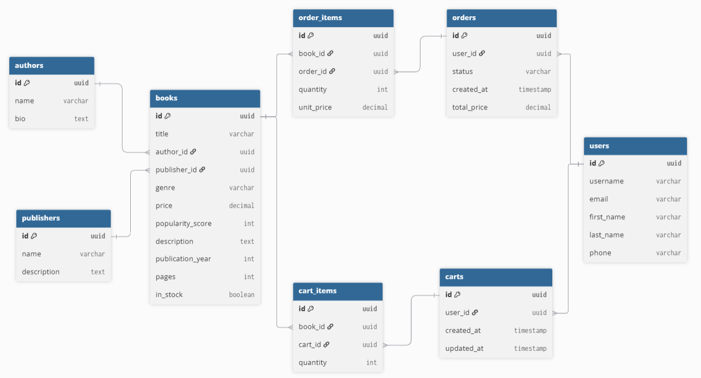

# 📚 Bookstore API

## 📝 Description
The **Bookstore API** is a RESTful backend service for managing a digital bookstore.

It provides a structured data model and endpoints to handle three core domains:
1. **Catalog Management**: Creating, retrieving, and filtering books, authors, and publishers.
2. **User Accounts**: Registering customers, secure authentication, and profile management.
3. **Sales Operations**: Managing digital shopping carts and processing order checkouts.

---

## 🚀 API Endpoints

### 📖 Books

| Endpoint       | Method     | Use                       | Request Params/Body                                                                                                                      | Status                                       | Response Body         |
|----------------|------------|---------------------------|------------------------------------------------------------------------------------------------------------------------------------------|----------------------------------------------|-----------------------|
| `/books/`      | **GET**    | List all books            | **Params**: `search` (title, author), `publisher`, `genre`, `ordering` (price, popularity, genre)                                        | `200 OK`                                     | Array of Book objects |
| `/books/`      | **POST**   | Create a new book         | **Body**: `{ title, author_id, publisher_id, genre, price, popularity_score, description, publication_year, pages, in_stock }`           | `201 Created`, `400 Bad Request`             | Created Book object   |
| `/books/{id}/` | **GET**    | Get specific book details | None                                                                                                                                     | `200 OK`, `404 Not Found`                    | Detailed Book object  |
| `/books/{id}/` | **PATCH**  | Update book data          | **Body**: `{ title?, author_id?, publisher_id?, genre?, price?, popularity_score?, description?, publication_year?, pages?, in_stock? }` | `200 OK`, `400 Bad Request`, `404 Not Found` | Updated Book object   |
| `/books/{id}/` | **DELETE** | Delete a book             | None                                                                                                                                     | `204 No Content`, `404 Not Found`            | None                  |

<details>
<summary><b>Examples</b></summary>

**`GET /books/?search=dune&genre=Sci-Fi&ordering=-price`** → `200 OK`
```json
[
  {
    "id": "9b2d4f6a-3c1e-4b8a-a5d7-2f6e8c0b1d3a",
    "title": "Dune",
    "author_id": "7c9e6679-7425-40de-944b-e07fc1f90ae7",
    "author_name": "Frank Herbert",
    "publisher_id": "550e8400-e29b-41d4-a716-446655440000",
    "publisher_name": "Penguin Books",
    "genre": "Sci-Fi",
    "price": "19.99",
    "popularity_score": 95,
    "in_stock": true
  }
]
```

**`POST /books/`**

Request:
```json
{
  "title": "Dune",
  "author_id": "7c9e6679-7425-40de-944b-e07fc1f90ae7",
  "publisher_id": "550e8400-e29b-41d4-a716-446655440000",
  "genre": "Sci-Fi",
  "price": "19.99",
  "popularity_score": 95,
  "description": "A science fiction novel set on the desert planet Arrakis.",
  "publication_year": 1965,
  "pages": 412,
  "in_stock": true
}
```
Response → `201 Created`:
```json
{
  "id": "9b2d4f6a-3c1e-4b8a-a5d7-2f6e8c0b1d3a",
  "title": "Dune",
  "author_id": "7c9e6679-7425-40de-944b-e07fc1f90ae7",
  "author_name": "Frank Herbert",
  "publisher_id": "550e8400-e29b-41d4-a716-446655440000",
  "publisher_name": "Penguin Books",
  "genre": "Sci-Fi",
  "price": "19.99",
  "popularity_score": 95,
  "description": "A science fiction novel set on the desert planet Arrakis.",
  "publication_year": 1965,
  "pages": 412,
  "in_stock": true
}
```
Response → `400 Bad Request`:
```json
{
  "title": ["This field is required."],
  "price": ["Ensure this value is greater than or equal to 0."]
}
```

**`GET /books/{id}/`** → `200 OK`: same shape as the `201 Created` response above.

**`PATCH /books/{id}/`**

Request:
```json
{
  "price": "14.99",
  "in_stock": false
}
```
Response → `200 OK`: the full updated Book object (same shape as above, with `"price": "14.99"` and `"in_stock": false`).

**`GET /books/{id}/`** with an unknown id → `404 Not Found`:
```json
{
  "detail": "Not found."
}
```

</details>

### ✍️ Authors

| Endpoint         | Method     | Use                      | Request Params/Body         | Status                                       | Response Body                           |
|------------------|------------|--------------------------|-----------------------------|----------------------------------------------|-----------------------------------------|
| `/authors/`      | **GET**    | List all authors         | None                        | `200 OK`                                     | Array of Author objects                 |
| `/authors/`      | **POST**   | Create a new author      | **Body**: `{ name, bio }`   | `201 Created`, `400 Bad Request`             | Created Author object                   |
| `/authors/{id}/` | **GET**    | Get author & their books | None                        | `200 OK`, `404 Not Found`                    | Author object (includes array of Books) |
| `/authors/{id}/` | **PATCH**  | Update author data       | **Body**: `{ name?, bio? }` | `200 OK`, `400 Bad Request`, `404 Not Found` | Updated Author object                   |
| `/authors/{id}/` | **DELETE** | Delete an author         | None                        | `204 No Content`, `404 Not Found`            | None                                    |

<details>
<summary><b>Examples</b></summary>

**`GET /authors/`** → `200 OK`
```json
[
  {
    "id": "7c9e6679-7425-40de-944b-e07fc1f90ae7",
    "name": "Frank Herbert",
    "bio": "American science fiction author."
  }
]
```

**`POST /authors/`**

Request:
```json
{
  "name": "Frank Herbert",
  "bio": "American science fiction author."
}
```
Response → `201 Created`:
```json
{
  "id": "7c9e6679-7425-40de-944b-e07fc1f90ae7",
  "name": "Frank Herbert",
  "bio": "American science fiction author."
}
```

**`GET /authors/{id}/`** → `200 OK`
```json
{
  "id": "7c9e6679-7425-40de-944b-e07fc1f90ae7",
  "name": "Frank Herbert",
  "bio": "American science fiction author.",
  "books": [
    {
      "id": "9b2d4f6a-3c1e-4b8a-a5d7-2f6e8c0b1d3a",
      "title": "Dune",
      "genre": "Sci-Fi",
      "price": "19.99",
      "popularity_score": 95
    }
  ]
}
```

**`PATCH /authors/{id}/`**

Request:
```json
{
  "bio": "American author best known for the Dune series."
}
```
Response → `200 OK`: the updated Author object.

</details>

### 🏢 Publishers

| Endpoint            | Method     | Use                         | Request Params/Body                 | Status                                       | Response Body                              |
|---------------------|------------|-----------------------------|-------------------------------------|----------------------------------------------|--------------------------------------------|
| `/publishers/`      | **GET**    | List all publishers         | None                                | `200 OK`                                     | Array of Publisher objects                 |
| `/publishers/`      | **POST**   | Create new publisher        | **Body**: `{ name, description }`   | `201 Created`, `400 Bad Request`             | Created Publisher object                   |
| `/publishers/{id}/` | **GET**    | Get publisher & their books | None                                | `200 OK`, `404 Not Found`                    | Publisher object (includes array of Books) |
| `/publishers/{id}/` | **PATCH**  | Update publisher data       | **Body**: `{ name?, description? }` | `200 OK`, `400 Bad Request`, `404 Not Found` | Updated Publisher object                   |
| `/publishers/{id}/` | **DELETE** | Delete a publisher          | None                                | `204 No Content`, `404 Not Found`            | None                                       |

<details>
<summary><b>Examples</b></summary>

**`GET /publishers/`** → `200 OK`
```json
[
  {
    "id": "550e8400-e29b-41d4-a716-446655440000",
    "name": "Penguin Books",
    "description": "British publishing house founded in 1935."
  }
]
```

**`POST /publishers/`**

Request:
```json
{
  "name": "Penguin Books",
  "description": "British publishing house founded in 1935."
}
```
Response → `201 Created`:
```json
{
  "id": "550e8400-e29b-41d4-a716-446655440000",
  "name": "Penguin Books",
  "description": "British publishing house founded in 1935."
}
```

**`GET /publishers/{id}/`** → `200 OK`
```json
{
  "id": "550e8400-e29b-41d4-a716-446655440000",
  "name": "Penguin Books",
  "description": "British publishing house founded in 1935.",
  "books": [
    {
      "id": "9b2d4f6a-3c1e-4b8a-a5d7-2f6e8c0b1d3a",
      "title": "Dune",
      "genre": "Sci-Fi",
      "price": "19.99",
      "popularity_score": 95
    }
  ]
}
```

**`PATCH /publishers/{id}/`**

Request:
```json
{
  "description": "One of the largest English-language publishers."
}
```
Response → `200 OK`: the updated Publisher object.

</details>

### 🔐 Authentication

| Endpoint                   | Method   | Use                  | Request Params/Body                                                                        | Status                                           | Response Body           |
|----------------------------|----------|----------------------|--------------------------------------------------------------------------------------------|--------------------------------------------------|-------------------------|
| `/accounts/register/`      | **POST** | Register a new user  | **Body**: `{ email, password, password_check, username, first_name?, last_name?, phone? }` | `201 Created`, `400 Bad Request`, `409 Conflict` | User object (No tokens) |
| `/accounts/login/`         | **POST** | Authenticate user    | **Body**: `{ username, password }`                                                         | `200 OK`, `401 Unauthorized`                     | `{ refresh, access }`   |
| `/accounts/login/refresh/` | **POST** | Refresh access token | **Body**: `{ refresh }`                                                                    | `200 OK`, `401 Unauthorized`                     | `{ access }`            |

<details>
<summary><b>Examples</b></summary>

**`POST /accounts/register/`**

Request:
```json
{
  "username": "jdoe",
  "email": "jdoe@example.com",
  "password": "StrongPassword123!",
  "password_check": "StrongPassword123!",
  "first_name": "John",
  "last_name": "Doe",
  "phone": "+380501234567"
}
```
Response → `201 Created`:
```json
{
  "id": "2c5ea4c0-4067-11e9-8bad-9b1deb4d3b7d",
  "username": "jdoe",
  "email": "jdoe@example.com",
  "first_name": "John",
  "last_name": "Doe",
  "phone": "+380501234567"
}
```
Response → `400 Bad Request`:
```json
{
  "password_check": ["Passwords do not match."]
}
```
Response → `409 Conflict`:
```json
{
  "error": "A user with this email already exists."
}
```

**`POST /accounts/login/`**

Request:
```json
{
  "username": "jdoe",
  "password": "StrongPassword123!"
}
```
Response → `200 OK`:
```json
{
  "refresh": "eyJhbGciOiJIUzI1NiIsInR5cCI6IkpXVCJ9.eyJ0b2tlbl90eXBlIjoicmVmcmVzaCJ9...",
  "access": "eyJhbGciOiJIUzI1NiIsInR5cCI6IkpXVCJ9.eyJ0b2tlbl90eXBlIjoiYWNjZXNzIn0..."
}
```
Response → `401 Unauthorized`:
```json
{
  "detail": "No active account found with the given credentials"
}
```

**`POST /accounts/login/refresh/`**

Request:
```json
{
  "refresh": "eyJhbGciOiJIUzI1NiIsInR5cCI6IkpXVCJ9.eyJ0b2tlbl90eXBlIjoicmVmcmVzaCJ9..."
}
```
Response → `200 OK`:
```json
{
  "access": "eyJhbGciOiJIUzI1NiIsInR5cCI6IkpXVCJ9.eyJ0b2tlbl90eXBlIjoiYWNjZXNzIn0..."
}
```

> All endpoints below require the header `Authorization: Bearer <access>`. Without a valid token they return `401 Unauthorized`:
> ```json
> { "detail": "Authentication credentials were not provided." }
> ```

</details>

### 👤 User Profile

| Endpoint      | Method    | Use                 | Request Params/Body                                                | Status                                                    | Response Body          |
|---------------|-----------|---------------------|--------------------------------------------------------------------|-----------------------------------------------------------|------------------------|
| `/me/`        | **GET**   | Get user profile    | None                                                               | `200 OK`, `401 Unauthorized`                              | User Profile object    |
| `/me/`        | **PATCH** | Update user profile | **Body**: `{ email?, password?, first_name?, last_name?, phone? }` | `200 OK`, `400 Bad Request`, `401 Unauthorized`           | Updated Profile object |
| `/me/orders/` | **GET**   | Get order history   | None                                                               | `200 OK`, `401 Unauthorized`                              | Array of Order objects |
| `/me/orders/` | **POST**  | Checkout / Buy cart | None                                                               | `201 Created`, `400 Bad Request`, `401 Unauthorized`      | Created Order object   |

<details>
<summary><b>Examples</b></summary>

**`GET /me/`** → `200 OK`
```json
{
  "id": "2c5ea4c0-4067-11e9-8bad-9b1deb4d3b7d",
  "username": "jdoe",
  "email": "jdoe@example.com",
  "first_name": "John",
  "last_name": "Doe",
  "phone": "+380501234567"
}
```

**`PATCH /me/`**

Request:
```json
{
  "first_name": "Johnny",
  "phone": "+380679876543"
}
```
Response → `200 OK`: the updated User Profile object (same shape as `GET /me/`).

**`GET /me/orders/`** → `200 OK`
```json
[
  {
    "id": "886313e1-3b8a-4372-9b90-0c9aee199e5d",
    "status": "pending",
    "total_price": "39.98",
    "created_at": "2026-10-26T14:30:00Z"
  }
]
```

**`POST /me/orders/`** (no body; the current cart is checked out and then emptied) → `201 Created`
```json
{
  "id": "886313e1-3b8a-4372-9b90-0c9aee199e5d",
  "status": "pending",
  "total_price": "39.98",
  "created_at": "2026-10-26T14:30:00Z",
  "items": [
    {
      "id": "0f8fad5b-d9cb-469f-a165-70867728950e",
      "book_id": "9b2d4f6a-3c1e-4b8a-a5d7-2f6e8c0b1d3a",
      "book_title": "Dune",
      "quantity": 2,
      "unit_price": "19.99",
      "item_total": "39.98"
    }
  ]
}
```
Response → `400 Bad Request`:
```json
{
  "error": "Cannot create an order from an empty cart."
}
```

</details>

### 🛒 Cart

| Endpoint                    | Method     | Use                   | Request Params/Body               | Status                                                                | Response Body           |
|-----------------------------|------------|-----------------------|-----------------------------------|-----------------------------------------------------------------------|-------------------------|
| `/me/cart/`                 | **GET**    | Get current cart      | None                              | `200 OK`, `401 Unauthorized`                                          | Cart object (items)     |
| `/me/cart/`                 | **DELETE** | Clear entire cart     | None                              | `204 No Content`, `401 Unauthorized`                                  | None                    |
| `/me/cart/items/`           | **POST**   | Add item to cart      | **Body**: `{ book_id, quantity }` | `201 Created`, `400 Bad Request`, `401 Unauthorized`, `404 Not Found` | Created CartItem object |
| `/me/cart/items/{book_id}/` | **PATCH**  | Update item quantity  | **Body**: `{ quantity }`          | `200 OK`, `400 Bad Request`, `401 Unauthorized`, `404 Not Found`      | Updated CartItem object |
| `/me/cart/items/{book_id}/` | **DELETE** | Remove item from cart | None                              | `204 No Content`, `401 Unauthorized`, `404 Not Found`                 | None                    |

<details>
<summary><b>Examples</b></summary>

**`GET /me/cart/`** → `200 OK`
```json
{
  "id": "6fa459ea-ee8a-4ca4-894e-db77e160355e",
  "items": [
    {
      "id": "16fd2706-8baf-433b-82eb-8c7fada847da",
      "book_id": "9b2d4f6a-3c1e-4b8a-a5d7-2f6e8c0b1d3a",
      "book_title": "Dune",
      "book_price": "19.99",
      "quantity": 2,
      "item_total": "39.98"
    }
  ],
  "total_price": "39.98",
  "created_at": "2026-10-26T14:00:00Z",
  "updated_at": "2026-10-26T14:10:00Z"
}
```

**`POST /me/cart/items/`**

Request:
```json
{
  "book_id": "9b2d4f6a-3c1e-4b8a-a5d7-2f6e8c0b1d3a",
  "quantity": 2
}
```
Response → `201 Created`:
```json
{
  "id": "16fd2706-8baf-433b-82eb-8c7fada847da",
  "book_id": "9b2d4f6a-3c1e-4b8a-a5d7-2f6e8c0b1d3a",
  "book_title": "Dune",
  "book_price": "19.99",
  "quantity": 2,
  "item_total": "39.98"
}
```
Response → `400 Bad Request`:
```json
{
  "book_id": ["This book is currently out of stock."]
}
```

**`PATCH /me/cart/items/{book_id}/`**

Request:
```json
{
  "quantity": 3
}
```
Response → `200 OK`:
```json
{
  "id": "16fd2706-8baf-433b-82eb-8c7fada847da",
  "book_id": "9b2d4f6a-3c1e-4b8a-a5d7-2f6e8c0b1d3a",
  "book_title": "Dune",
  "book_price": "19.99",
  "quantity": 3,
  "item_total": "59.97"
}
```

</details>

---

## 🗄️ Database Schema


